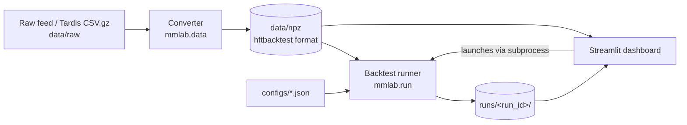

# Infrastructure

What exists in the repository and how the pieces fit together. Status markers: **done** (exists and works), **planned** (specified in plan.md, not built). Update this file in the same change that alters any of it; see "Keeping docs current" in [AGENTS.md](../AGENTS.md).

## Environment

| Item | Value |
|---|---|
| OS | Windows 11, native (no WSL). WSL2 is a fallback only if hftbacktest or Numba misbehaves |
| Python | 3.12, pinned in `.python-version` (uv would otherwise pick 3.15, which lacks wheels for several dependencies) |
| Package manager | uv; `pyproject.toml` and `uv.lock` are committed |
| Project name / import package | `mm-lab` / `mmlab` |
| Remote | https://github.com/Sh1ljo/MMCrypto.git, branch `main` |

Key pinned versions (see `uv.lock` for the full set): hftbacktest 2.4.4, numba 0.68.0, numpy 2.2.6, polars 2.0.0, pyarrow 26.0.0, duckdb 1.5.6, streamlit 1.66.0, plotly 7.1.0, pydantic 2.14.1, scipy 1.18.1, statsmodels 0.15.0, tardis-dev 5.0.1. Dev: pytest, ruff, ipykernel.

## Data flow



The dashboard never runs backtest logic. It writes a config, starts the runner as a subprocess, and reads the saved run folder. Every result is a reproducible folder on disk.

## Repository layout

```
.
├── AGENTS.md              agent entry point (CLAUDE.md imports it)
├── CLAUDE.md              one line: @AGENTS.md
├── CONTEXT.md             running notes, decisions, results, known issues
├── README.md              human setup and commands
├── plan.md                phased build guide (source of truth for intent)
├── pyproject.toml         dependencies (uv)
├── uv.lock                locked versions
├── .python-version        3.12
├── docs/
│   ├── CODING.md          code style and comment rules
│   └── INFRASTRUCTURE.md  this file
├── scripts/               one-off exploratory scripts
├── configs/               run configs (JSON); configs/_ui/ is dashboard-generated, gitignored
├── data/
│   ├── raw/               downloaded feeds (gitignored)
│   └── npz/               converted hftbacktest files (gitignored)
├── runs/                  one folder per backtest run (gitignored)
├── mmlab/                 the library
│   ├── settings.py        data paths (MMLAB_DATA_DIR override)
│   ├── data/              download, instruments, convert, validate, manifest, CLI
│   ├── strategies/        naive, avellaneda, glft, alpha_skew
│   ├── calibration/       volatility, intensity (A, k)
│   └── analytics/         metrics, markouts
├── dashboard/
│   └── pages/             Streamlit pages
└── tests/                 pytest sanity and unit tests
```

Empty directories (`configs/`, `dashboard/pages/`) exist locally but are not tracked by git until they hold files.

## Data pipeline (Phase 1)

```bash
uv run python -m mmlab.data download --symbol BTCUSDT --from 2026-09-01 --to 2026-09-02
uv run python -m mmlab.data ingest --symbol BTCUSDT --date 2026-09-01 --chunk-hours 1 --max-memory-gb 8
```

- `download` fetches `trades` and `incremental_book_L2` for `binance-futures`. `--to` is exclusive. Files land in `data/raw/` using Tardis naming (`binance-futures_trades_2026-09-01_BTCUSDT.csv.gz`). Free first-of-month days reportedly need no key (unverified); set `TARDIS_API_KEY` for other days.
- `ingest` splits one day into time slices of `--chunk-hours` (default 1, by local timestamp), converts each slice to `data/npz/<symbol>_<yyyymmdd>_pNNN.npz`, validates the slices as one stream (list of npz files, replayed in order),  and upserts `data/manifest.json` (version 2: one entry per symbol and day with a `paths` list). Tick and lot size come from `--tick-size` and `--lot-size`, or from Binance `exchangeInfo` when omitted. The exit code is 1 when validation fails; the manifest entry is still written with its problems listed.
- Trades are passed to the converter before the book file, as hftbacktest requires.
- Tardis includes a start-of-day book snapshot, so end-of-day snapshots are not needed to start a day. `convert.write_eod_snapshot` exists for chaining consecutive days if ever wanted.
- Moving data off the repo drive: set `MMLAB_DATA_DIR` to any folder. Manifest paths are stored relative to it.

### Memory sizing

`convert.count_rows` streams each gzipped CSV and counts rows and snapshot rows. The event buffer is `trade rows + book rows + 2 x snapshot rows`, which is an exact upper bound. Each event is 64 bytes. `estimated_peak_gb` multiplies the buffer by a rough factor of 4 for the CSV frame and sort copies; that factor is not yet confirmed on a real day. Estimates apply per slice. Use `--max-memory-gb` to refuse any slice that would exceed what a machine can hold. A full BTCUSDT day in one piece was estimated at 35.4 GB and was killed at 22 GB, which is why conversion is chunked.

Slicing (`mmlab/data/split.py`): the book is cut at the first non-snapshot row after each boundary, so a snapshot block is never split. Trades are cut at the same instants. Slice files are temporary and deleted after conversion. `correct_local_timestamp` runs per slice; it only changes data when feed latency is negative.

### Validation

| Check | Meaning |
|---|---|
| `max_gap_s` | Largest gap between consecutive events by local timestamp. Default limit 60 s |
| `broken_samples` | Samples (default every 10 ms) where one side of the book is empty or best bid is at or above best ask, after the book first has both sides. Default limit 1e-4 of samples |
| `spread_ticks_*` | Spread distribution in ticks over valid samples |
| `trades_per_min_*` | Trade rate per minute across the day |

hftbacktest repairs a crossed book by deleting the stale levels on the opposite side, so a true crossing is never visible as `best bid >= best ask`. It shows up as a wiped side, which `broken_samples` counts. A crossing that leaves both sides non-empty goes undetected by this sampled check; an event-level order book check would be needed to catch it.

## Modules

| Path | Purpose | Phase | Status |
|---|---|---|---|
| `scripts/phase0_convert.py` | Convert the sample Binance feed dumps to `.npz` and build the end-of-day snapshot | 0 | done |
| `scripts/phase0_tutorial.py` | hftbacktest Getting Started: BBO printer, symmetric GTX quoter, `LinearAssetRecord` stats | 0 | done |
| `mmlab/__init__.py` and subpackage `__init__.py` files | Empty package markers | 0 | done |
| `mmlab/settings.py` | Data paths; `MMLAB_DATA_DIR` moves `raw/`, `npz/` and `manifest.json` to another drive | 1 | done |
| `mmlab/data/download.py` | Tardis download via `tardis_dev.download_datasets`; Tardis file naming; key from `TARDIS_API_KEY` | 1 | done, untested against the real service |
| `mmlab/data/instruments.py` | Tick and lot size from Binance public `exchangeInfo` | 1 | done, untested against the real service |
| `mmlab/data/split.py` | Streams gzipped Tardis CSVs into time slices without cutting snapshot blocks | 1 | done |
| `mmlab/data/convert.py` | Tardis CSV to `.npz`; counts CSV rows first and sizes buffers exactly; optional memory guard; `convert_day_chunked` converts a day slice by slice; optional end-of-day snapshot | 1 | done |
| `mmlab/data/validate.py` | Event statistics (count, span, largest gap, trades per minute) and a sampled book replay (spread in ticks, broken samples); pass/fail limits | 1 | done |
| `mmlab/data/manifest.py` | `data/manifest.json` read, atomic upsert, version check | 1 | done |
| `mmlab/data/__main__.py` | CLI: `download` and `ingest` (convert, validate, register) | 1 | done |
| `mmlab/config.py` | Pydantic `RunConfig` / `ExecConfig` | 2 | planned |
| `mmlab/strategies/naive.py` | Symmetric quoter | 2 | planned |
| `mmlab/run.py` | CLI: `python -m mmlab.run --config ...`; builds backtest, runs strategy, saves artifacts | 2 | planned |
| `mmlab/analytics/metrics.py` | Net/gross PnL, Sharpe, drawdown, and others (plan.md Section 7) | 2 | planned |
| `dashboard/app.py` and `dashboard/pages/*` | Run list, run launcher, explorer, compare, sweeps, data explorer | 3 | planned |
| `mmlab/analytics/markouts.py` | Markout curves | 4 | planned |
| `mmlab/strategies/avellaneda.py`, `glft.py` | Inventory-aware optimal quoting | 5 | planned |
| `mmlab/calibration/volatility.py`, `intensity.py` | Causal rolling estimates of sigma, A, k | 5 | planned |
| `mmlab/strategies/alpha_skew.py` | Imbalance / OFI fair-price shift | 6 | planned |
| `mmlab/sweep.py` | Parameter grids, walk-forward | 7 | planned |

## Current data inventory

Gitignored, so present only on the machine that created them.

| File | What it is |
|---|---|
| `data/raw/btcusdt_20240808.gz`, `btcusdt_20240809.gz` | hftbacktest sample raw Binance Futures feed (from `nkaz001/hftbacktest`, `examples/usdm`) |
| `data/npz/btcusdt_20240808.npz`, `btcusdt_20240809.npz` | Converted feed. Each covers only about 5 minutes |
| `data/npz/btcusdt_20240808_eod.npz` | End-of-day snapshot of 08-08, used as the initial snapshot for 08-09 |

No Tardis day has been downloaded yet; Phase 1 code was written and tested on synthetic data first. `data/manifest.json` is gitignored because its entries describe machine-local files.

Instrument parameters for BTCUSDT: tick size 0.1, lot size 0.001. Always re-check against exchange info for other symbols.

## Interfaces (frozen once Phase 2 lands)

- **Config schema:** `RunConfig` and `ExecConfig`, defined in plan.md Section 2.1. Changes require a version bump written into `config.json`.
- **Run artifact format:** plan.md Section 2.5.

```
runs/<date>_<time>_<name>_<hash>/
├── config.json         exact RunConfig used + git commit hash + hftbacktest version
├── metrics.json        summary metrics + status + runtime
├── timeseries.parquet  ts, mid, bid_quote, ask_quote, position, balance, fee, equity, num_trades
├── fills.parquet       ts, side, price, qty, mid_at_fill
└── log.txt
```

The recorder (hftbacktest 2.4.4) exposes `timestamp, price, position, balance, fee, num_trades, trading_volume, trading_value`.

## Tests

`uv run pytest` runs everything with synthetic data; no downloads, no network, no real data needed. `tests/conftest.py` writes tiny Tardis-format `.csv.gz` files (one bid, one ask, an update per second, a trade every 5 seconds) with optional gaps and a book-wiping crossing. Test files: `test_settings`, `test_data_download` (download is monkeypatched), `test_data_instruments`, `test_data_convert` (including chunked conversion and snapshot-safe splitting), `test_data_validate`, `test_data_manifest`, `test_data_cli` (full ingest end to end).

## Library notes

- `tardis_dev` 5.x exposes `download_datasets`, not the `datasets.download` shown in older examples and in plan.md.
- `wait_next_feed` returns 2 per market feed and 1 at end of data; the last event is not delivered before the end-of-data return.

- `BacktestAsset.constant_latency()` is deprecated in 2.4.4; use `constant_order_latency()`.
- `Stats.summary()` returns a Polars DataFrame and does not print.
- The Binance converter prints `local_timestamp is ahead of exch_timestamp` and corrects the feed latency. Keep this in mind for Phase 4 latency analysis.
- A backtest object cannot be reused; build a fresh one per run.

## Commands

See the Commands section of [AGENTS.md](../AGENTS.md).

## Data storage

Budget about 1-2 GB per day per symbol (raw plus converted) for real Tardis days. Delete `data/raw/` after successful conversion and validation; keep the manifest.
