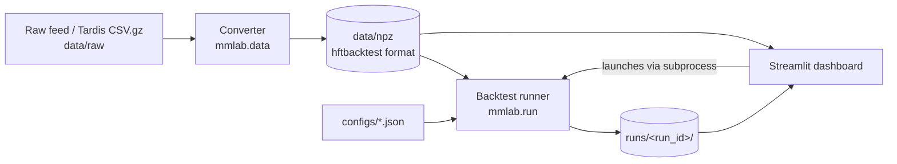

# Infrastructure

What exists in the repository and how the pieces fit together. Status markers: **done** (exists and works), **planned** (specified in plan.md, not built). Update this file in the same change that alters any of it; see "Keeping docs current" in [AGENTS.md](../AGENTS.md).

## Environment

| Item | Value |
|---|---|
| OS | Windows 11, native (no WSL). WSL2 is a fallback only if hftbacktest or Numba misbehaves |
| Python | 3.12, pinned in `.python-version` (uv would otherwise pick 3.15, which lacks wheels for several dependencies) |
| Package manager | uv; `pyproject.toml` and `uv.lock` are committed |
| Project name / import package | `mm-lab` / `mmlab` |
| Remote | https://github.com/Sh1ljo/MMCrypto.git, branch `main` |

Key pinned versions (see `uv.lock` for the full set): hftbacktest 2.4.4, numba 0.68.0, numpy 2.2.6, polars 2.0.0, pyarrow 26.0.0, duckdb 1.5.6, streamlit 1.66.0, plotly 7.1.0, pydantic 2.14.1, scipy 1.18.1, statsmodels 0.15.0, tardis-dev 5.0.1. Dev: pytest, ruff, ipykernel.

## Data flow



The dashboard never runs backtest logic. It writes a config, starts the runner as a subprocess, and reads the saved run folder. Every result is a reproducible folder on disk.

## Repository layout

```
.
├── AGENTS.md              agent entry point (CLAUDE.md imports it)
├── CLAUDE.md              one line: @AGENTS.md
├── CONTEXT.md             running notes, decisions, results, known issues
├── README.md              human setup and commands
├── plan.md                phased build guide (source of truth for intent)
├── pyproject.toml         dependencies (uv)
├── uv.lock                locked versions
├── .python-version        3.12
├── docs/
│   ├── CODING.md          code style and comment rules
│   └── INFRASTRUCTURE.md  this file
├── scripts/               one-off exploratory scripts
├── configs/               run configs (JSON); configs/_ui/ is dashboard-generated, gitignored
├── data/
│   ├── raw/               downloaded feeds (gitignored)
│   └── npz/               converted hftbacktest files (gitignored)
├── runs/                  one folder per backtest run (gitignored)
├── mmlab/                 the library
│   ├── data/              download, convert, validate
│   ├── strategies/        naive, avellaneda, glft, alpha_skew
│   ├── calibration/       volatility, intensity (A, k)
│   └── analytics/         metrics, markouts
├── dashboard/
│   └── pages/             Streamlit pages
└── tests/                 pytest sanity and unit tests
```

Empty directories (`configs/`, `dashboard/pages/`, `tests/`) exist locally but are not tracked by git until they hold files.

## Modules

| Path | Purpose | Phase | Status |
|---|---|---|---|
| `scripts/phase0_convert.py` | Convert the sample Binance feed dumps to `.npz` and build the end-of-day snapshot | 0 | done |
| `scripts/phase0_tutorial.py` | hftbacktest Getting Started: BBO printer, symmetric GTX quoter, `LinearAssetRecord` stats | 0 | done |
| `mmlab/__init__.py` and subpackage `__init__.py` files | Empty package markers | 0 | done |
| `mmlab/config.py` | Pydantic `RunConfig` / `ExecConfig` | 2 | planned |
| `mmlab/data/download.py` | Tardis download | 1 | planned |
| `mmlab/data/convert.py` | CSV to `.npz` plus end-of-day snapshots | 1 | planned |
| `mmlab/data/validate.py` | Data integrity checks, writes `data/manifest.json` | 1 | planned |
| `mmlab/strategies/naive.py` | Symmetric quoter | 2 | planned |
| `mmlab/run.py` | CLI: `python -m mmlab.run --config ...`; builds backtest, runs strategy, saves artifacts | 2 | planned |
| `mmlab/analytics/metrics.py` | Net/gross PnL, Sharpe, drawdown, and others (plan.md Section 7) | 2 | planned |
| `dashboard/app.py` and `dashboard/pages/*` | Run list, run launcher, explorer, compare, sweeps, data explorer | 3 | planned |
| `mmlab/analytics/markouts.py` | Markout curves | 4 | planned |
| `mmlab/strategies/avellaneda.py`, `glft.py` | Inventory-aware optimal quoting | 5 | planned |
| `mmlab/calibration/volatility.py`, `intensity.py` | Causal rolling estimates of sigma, A, k | 5 | planned |
| `mmlab/strategies/alpha_skew.py` | Imbalance / OFI fair-price shift | 6 | planned |
| `mmlab/sweep.py` | Parameter grids, walk-forward | 7 | planned |

## Current data inventory

Gitignored, so present only on the machine that created them.

| File | What it is |
|---|---|
| `data/raw/btcusdt_20240808.gz`, `btcusdt_20240809.gz` | hftbacktest sample raw Binance Futures feed (from `nkaz001/hftbacktest`, `examples/usdm`) |
| `data/npz/btcusdt_20240808.npz`, `btcusdt_20240809.npz` | Converted feed. Each covers only about 5 minutes |
| `data/npz/btcusdt_20240808_eod.npz` | End-of-day snapshot of 08-08, used as the initial snapshot for 08-09 |

Instrument parameters for BTCUSDT: tick size 0.1, lot size 0.001. Always re-check against exchange info for other symbols.

## Interfaces (frozen once Phase 2 lands)

- **Config schema:** `RunConfig` and `ExecConfig`, defined in plan.md Section 2.1. Changes require a version bump written into `config.json`.
- **Run artifact format:** plan.md Section 2.5.

```
runs/<date>_<time>_<name>_<hash>/
├── config.json         exact RunConfig used + git commit hash + hftbacktest version
├── metrics.json        summary metrics + status + runtime
├── timeseries.parquet  ts, mid, bid_quote, ask_quote, position, balance, fee, equity, num_trades
├── fills.parquet       ts, side, price, qty, mid_at_fill
└── log.txt
```

The recorder (hftbacktest 2.4.4) exposes `timestamp, price, position, balance, fee, num_trades, trading_volume, trading_value`.

## Library notes

- `BacktestAsset.constant_latency()` is deprecated in 2.4.4; use `constant_order_latency()`.
- `Stats.summary()` returns a Polars DataFrame and does not print.
- The Binance converter prints `local_timestamp is ahead of exch_timestamp` and corrects the feed latency. Keep this in mind for Phase 4 latency analysis.
- A backtest object cannot be reused; build a fresh one per run.

## Commands

See the Commands section of [AGENTS.md](../AGENTS.md).

## Data storage

Budget about 1-2 GB per day per symbol (raw plus converted) for real Tardis days. Delete `data/raw/` after successful conversion and validation; keep the manifest.
