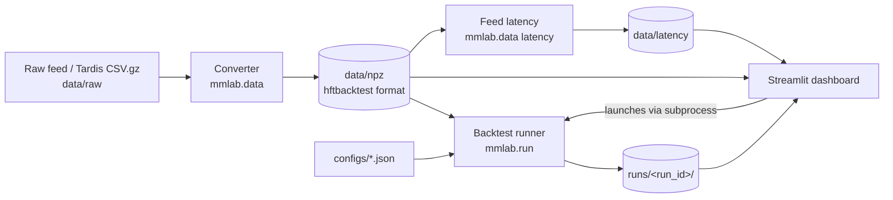

# Infrastructure

What exists in the repository and how the pieces fit together. Status markers: **done** (exists and works), **planned** (specified in plan.md, not built). Update this file in the same change that alters any of it; see "Keeping docs current" in [AGENTS.md](../AGENTS.md).

## Environment

| Item | Value |
|---|---|
| OS | Windows 11, native (no WSL). WSL2 is a fallback only if hftbacktest or Numba misbehaves |
| Python | 3.12, pinned in `.python-version` (uv would otherwise pick 3.15, which lacks wheels for several dependencies) |
| Package manager | uv; `pyproject.toml` and `uv.lock` are committed |
| Project name / import package | `mm-lab` / `mmlab` |
| Remote | https://github.com/Sh1ljo/MMCrypto.git, branch `main` |

Key pinned versions (see `uv.lock` for the full set): hftbacktest 2.4.4, numba 0.68.0, numpy 2.2.6, polars 2.0.0, pyarrow 26.0.0, duckdb 1.5.6, streamlit 1.66.0, plotly 7.1.0, pydantic 2.14.1, scipy 1.18.1, statsmodels 0.15.0, tardis-dev 5.0.1. Dev: pytest, ruff, ipykernel.

## Data flow



The dashboard never runs backtest logic. It writes a config, starts the runner as a subprocess, and reads the saved run folder. Every result is a reproducible folder on disk.

## Repository layout

```
.
├── AGENTS.md              agent entry point (CLAUDE.md imports it)
├── CLAUDE.md              one line: @AGENTS.md
├── CONTEXT.md             running notes, decisions, results, known issues
├── README.md              human setup and commands
├── plan.md                phased build guide (source of truth for intent)
├── pyproject.toml         dependencies (uv)
├── uv.lock                locked versions
├── .python-version        3.12
├── docs/
│   ├── CODING.md          code style and comment rules
│   └── INFRASTRUCTURE.md  this file
├── scripts/               one-off scripts: Phase 0 tutorial, Phase 4 sensitivity runs (run as `python -m scripts.<name>`)
├── configs/               run configs (JSON); configs/_ui/ is dashboard-generated, gitignored
├── data/
│   ├── raw/               downloaded feeds (gitignored)
│   ├── npz/               converted hftbacktest files (gitignored)
│   └── latency/           feed latency report per day (gitignored)
├── runs/                  one folder per backtest run (gitignored)
├── mmlab/                 the library
│   ├── settings.py        data paths (MMLAB_DATA_DIR override)
│   ├── config.py          RunConfig / ExecConfig / RunRecord (config version 1)
│   ├── run.py             backtest runner CLI
│   ├── data/              download, instruments, convert, validate, manifest, latency, CLI
│   ├── strategies/        recording (shared), naive; later avellaneda, glft, alpha_skew
│   ├── calibration/       volatility, intensity (A, k)
│   └── analytics/         metrics, markouts
├── dashboard/             Streamlit app (Phase 3 and 4)
│   ├── app.py             entry point: page config and navigation only
│   ├── home.py            Home page: table of every run
│   ├── lib.py             run discovery, config form, resampling, subprocess launcher, quote preview (no Streamlit)
│   ├── charts.py          Plotly figures and the light/dark chart palette (no Streamlit)
│   ├── help_text.py       every tooltip and the glossary, in one place
│   ├── ui.py              Streamlit helpers shared by pages (KPI rows, open-in-explorer)
│   └── pages/             1_Run_Backtest.py, 2_Run_Explorer.py, 3_Strategies.py, 4_Compare_Runs.py, 5_Data_Explorer.py
├── .streamlit/config.toml no email prompt, no usage stats, minimal toolbar
└── tests/                 pytest sanity and unit tests
```

Empty directories (`configs/`) exist locally but are not tracked by git until they hold files.

## Data pipeline (Phase 1)

```bash
uv run python -m mmlab.data download --symbol BTCUSDT --from 2026-09-01 --to 2026-09-02
uv run python -m mmlab.data ingest --symbol BTCUSDT --date 2026-09-01 --chunk-hours 1 --max-memory-gb 8
uv run python -m mmlab.data latency --symbol BTCUSDT --date 2026-09-01
```

- `download` fetches `trades` and `incremental_book_L2` for `binance-futures`. `--to` is exclusive. Files land in `data/raw/` using Tardis naming (`binance-futures_trades_2026-09-01_BTCUSDT.csv.gz`). Free first-of-month days reportedly need no key (unverified); set `TARDIS_API_KEY` for other days.
- `ingest` splits one day into time slices of `--chunk-hours` (default 1, by local timestamp), converts each slice to `data/npz/<symbol>_<yyyymmdd>_pNNN.npz`, validates the slices as one stream (list of npz files, replayed in order),  and upserts `data/manifest.json` (version 2: one entry per symbol and day with a `paths` list). Tick and lot size come from `--tick-size` and `--lot-size`, or from Binance `exchangeInfo` when omitted. The exit code is 1 when validation fails; the manifest entry is still written with its problems listed.
- `latency` measures the feed latency of one ingested day (`local_ts - exch_ts` per market event, snapshot rows excluded, an event split into an exchange row and a local row counted once) and writes `data/latency/<symbol>_<yyyymmdd>.json`: percentiles, a log-spaced histogram (20 bins per decade, 0.1 ms to 10 s) and a summary per file. It reads every file of the day once and takes about 30 s for a full BTCUSDT day. A latency outside the histogram range raises. The Data Explorer page runs the same measurement from a button.
- Trades are passed to the converter before the book file, as hftbacktest requires.
- Tardis includes a start-of-day book snapshot, so end-of-day snapshots are not needed to start a day. `convert.write_eod_snapshot` exists for chaining consecutive days if ever wanted.
- Moving data off the repo drive: set `MMLAB_DATA_DIR` to any folder. Manifest paths are stored relative to it.

### Memory sizing

`convert.count_rows` streams each gzipped CSV and counts rows and snapshot rows. The event buffer is `trade rows + book rows + 2 x snapshot rows`, which is an exact upper bound. Each event is 64 bytes. `estimated_peak_gb` multiplies the buffer by a rough factor of 4 for the CSV frame and sort copies; that factor is not yet confirmed on a real day. Estimates apply per slice. Use `--max-memory-gb` to refuse any slice that would exceed what a machine can hold. A full BTCUSDT day in one piece was estimated at 35.4 GB and was killed at 22 GB, which is why conversion is chunked.

Slicing (`mmlab/data/split.py`): the book is cut at the first non-snapshot row after each boundary, so a snapshot block is never split. Trades are cut at the same instants. Slice files are temporary and deleted after conversion. `correct_local_timestamp` runs per slice; it only changes data when feed latency is negative.

### Validation

| Check | Meaning |
|---|---|
| `max_gap_s` | Largest gap between consecutive events by local timestamp. Default limit 60 s |
| `broken_samples` | Samples (default every 10 ms) where one side of the book is empty or best bid is at or above best ask, after the book first has both sides. Default limit 1e-4 of samples |
| `spread_ticks_*` | Spread distribution in ticks over valid samples |
| `trades_per_min_*` | Trade rate per minute across the day |

hftbacktest repairs a crossed book by deleting the stale levels on the opposite side, so a true crossing is never visible as `best bid >= best ask`. It shows up as a wiped side, which `broken_samples` counts. A crossing that leaves both sides non-empty goes undetected by this sampled check; an event-level order book check would be needed to catch it.

## Modules

| Path | Purpose | Phase | Status |
|---|---|---|---|
| `scripts/phase0_convert.py` | Convert the sample Binance feed dumps to `.npz` and build the end-of-day snapshot | 0 | done |
| `scripts/phase0_tutorial.py` | hftbacktest Getting Started: BBO printer, symmetric GTX quoter, `LinearAssetRecord` stats | 0 | done |
| `mmlab/__init__.py` and subpackage `__init__.py` files | Empty package markers | 0 | done |
| `mmlab/settings.py` | Data paths; `MMLAB_DATA_DIR` moves `raw/`, `npz/` and `manifest.json` to another drive | 1 | done |
| `mmlab/data/download.py` | Tardis download via `tardis_dev.download_datasets`; Tardis file naming; key from `TARDIS_API_KEY` | 1 | done, untested against the real service |
| `mmlab/data/instruments.py` | Tick and lot size from Binance public `exchangeInfo` | 1 | done, untested against the real service |
| `mmlab/data/split.py` | Streams gzipped Tardis CSVs into time slices without cutting snapshot blocks | 1 | done |
| `mmlab/data/convert.py` | Tardis CSV to `.npz`; counts CSV rows first and sizes buffers exactly; optional memory guard; `convert_day_chunked` converts a day slice by slice; optional end-of-day snapshot | 1 | done |
| `mmlab/data/validate.py` | Event statistics (count, span, largest gap, trades per minute) and a sampled book replay (spread in ticks, broken samples); pass/fail limits | 1 | done |
| `mmlab/data/manifest.py` | `data/manifest.json` read, atomic upsert, version check | 1 | done |
| `mmlab/data/latency.py` | Feed latency of a registered day: exact percentiles, histogram, per-file summary; save and load of `data/latency/*.json` | 4 | done |
| `mmlab/data/__main__.py` | CLI: `download`, `ingest` (convert, validate, register) and `latency` | 1, 4 | done |
| `mmlab/config.py` | Pydantic `RunConfig` / `ExecConfig` (unknown fields rejected; `mid_sample_ns` must divide `step_ns`) and `RunRecord` (config plus version, git commit, dirty flag, hftbacktest version); `CONFIG_VERSION` 2, versions 1 and 2 readable | 2, 4 | done |
| `mmlab/strategies/recording.py` | Numba helpers every strategy uses: `elapse_step` (advance one decision step in `mid_sample_ns` slices), `sample_mid`, `record_fills`; the fill and mid record dtypes | 4 | done |
| `mmlab/strategies/naive.py` | Symmetric post-only quoter, Numba-compiled; fills `fills_out` and `mids_out` through the recording helpers and returns (steps, fills, mid samples); param `half_spread_ticks`; buy order ids are `2 x tick`, sell ids `2 x tick + 1`; a side is not quoted when the position limit would be passed. The two quoting rules are the functions `quote_ticks` and `quote_sides`, which the dashboard's Strategies page also calls (as plain Python through `.py_func`) so its calculator cannot drift from the strategy | 2 | done |
| `mmlab/run.py` | CLI: `python -m mmlab.run --config ...`; builds backtest (rejects `partial_fill`), runs strategy, sorts the exact fills, joins the mid at each fill, checks the fills against the recorder, saves artifacts, writes `status: failed` and re-raises on error. Relative `data_files` resolve against the data dir | 2, 4 | done |
| `mmlab/analytics/metrics.py` | Summary metrics (plan.md Section 7), including markout KPIs and the inventory half-life | 2, 4 | done |
| `mmlab/analytics/markouts.py` | `markouts(fills, mids, end_ts)`: average markout in price and bps with its standard error at each horizon (100 ms to 60 s by default) | 4 | done |
| `scripts/phase4_sensitivity.py` | Runs the Phase 4 one-factor-at-a-time grid (half spread, queue model, latency, fee) for one day and prints a table; `--only-base` runs just the 5-tick case | 4 | done |
| `dashboard/app.py` | Entry point: `set_page_config` and `st.navigation`, with a Lab section (Home, Run Backtest, Run Explorer, Compare Runs, Data Explorer) and a Learn section (Strategies) | 3, 4 | done |
| `dashboard/home.py` | Table of every run folder (status, data, params, PnL, Sharpe, drawdown, fills, markout 1 s); selecting a row opens it in the explorer | 3, 4 | done |
| `dashboard/pages/1_Run_Backtest.py` | Form for one manifest day, strategy and execution settings; writes `configs/_ui/<name>.json`, launches `mmlab.run` as a subprocess, shows the live log and the headline KPIs | 3 | done |
| `dashboard/pages/2_Run_Explorer.py` | One run: KPI rows (with markouts and half-life), time window and resolution, price / position / equity panels, markout curve, distributions, table view, config and log | 3, 4 | done |
| `dashboard/pages/4_Compare_Runs.py` | 2 to 8 finished runs: numbers table, net PnL overlay, markout overlay, and only the settings that differ | 4 | done |
| `dashboard/pages/5_Data_Explorer.py` | One registered day: summary from the ingest checks, feed latency report (histogram and per-file lines) with a Measure button | 4 | done |
| `dashboard/pages/3_Strategies.py` | Tabs for the naive quoter (built: rules with formulas, an interactive quote calculator, settings, the result so far), Avellaneda–Stoikov, GLFT and alpha skew (planned, formulas from plan.md Section 5 and 6), the metric formulas, and a glossary | 3 | done |
| `dashboard/lib.py` | `list_runs` / `load_run` (config versions 1 and 2), `runs_table`, `RunForm` (user units to `RunConfig`), `read_timeseries` / `read_fills` / `read_markouts` / `read_equity`, `RunProcess` (subprocess with a reader thread), `preview_quotes` (the naive strategy's own quoting functions, run as plain Python), and the compare helpers `assign_slots`, `compare_labels`, `config_diff`, `metrics_comparison` | 3, 4 | done |
| `dashboard/charts.py` | `run_figure`, `distribution_figure`, `ladder_figure`, `markout_figure`, `compare_markout_figure`, `compare_equity_figure`, `latency_histogram_figure`, `latency_by_file_figure`, `colors_for` (validated light and dark palettes, eight categorical slots) | 3, 4 | done |
| `dashboard/help_text.py` | `HELP` (one plain-English tooltip per input, metric and section) and `GLOSSARY` | 3 | done |
| `dashboard/ui.py` | `show_kpis`, `show_detail_kpis`, `show_markout_kpis`, `open_in_explorer` | 3, 4 | done |
| Data Explorer: order-book heatmap and trade intensity over time | plan.md Section 3.5 | later | planned |
| Dashboard Sweeps page | Parameter heatmaps | 7 | planned |
| `mmlab/strategies/avellaneda.py`, `glft.py` | Inventory-aware optimal quoting | 5 | planned |
| `mmlab/calibration/volatility.py`, `intensity.py` | Causal rolling estimates of sigma, A, k | 5 | planned |
| `mmlab/strategies/alpha_skew.py` | Imbalance / OFI fair-price shift | 6 | planned |
| `mmlab/sweep.py` | Parameter grids, walk-forward | 7 | planned |

## Dashboard (Phase 3 and 4)

```bash
uv run python -m streamlit run dashboard/app.py
```

Run it from the repository root with `python -m streamlit`, not the bare `streamlit` command. `mmlab` and `dashboard` are not installed packages, and Streamlit puts only the script's own folder on `sys.path`; `python -m` adds the working directory, which is what makes `import mmlab` work. The server listens on http://localhost:8501. `.streamlit/config.toml` turns off the first-run email prompt and usage statistics and hides the Deploy button.

The dashboard never runs backtest logic. It reads `data/manifest.json` and `runs/`, and the Run Backtest page starts `python -m mmlab.run --config configs/_ui/<name>.json` as a subprocess with the same interpreter. A reader thread collects the merged stdout and stderr and the page polls it every 0.25 s; `PYTHONIOENCODING=utf-8` is set for the child so a Windows console code page cannot break the log.

| Page | Behaviour |
|---|---|
| Home | One row per folder under `runs/`, newest first. Status is `ok`, `failed` (the runner wrote `status: failed`), `incomplete` (`config.json` but no `metrics.json`: still running or killed) or `unreadable` (shown with its error instead of crashing the table). The data column is looked up in the manifest by file names. |
| Run Backtest | Pick one manifest day and how many of its files to replay, then strategy and quoting settings; fees, delays and queue model sit in a collapsed "Execution assumptions" expander. A run always replays a prefix of the day, because only the first file starts with the book snapshot; a later file alone would start from an empty book. Several days in one run are not offered (state across non-consecutive days is unverified). Fees are entered in bps and latencies and the step in ms, and converted to the config's fractions and nanoseconds; the form's defaults reproduce the CLI defaults exactly (tested). The run name is optional (default `naive_hs5_20261001`, with `_<n>f` for a prefix) and must match `[A-Za-z0-9][A-Za-z0-9_.-]*`. The button is disabled when a data file is missing on disk or the day failed validation. The log shows the run folder name, the data span and the finish only, because the replay is one compiled loop with no per-step output; an elapsed timer shows it is alive. Leaving the page does not stop the run. |
| Strategies | Tabs: Naive (built), Avellaneda–Stoikov, GLFT and Alpha skew (each badged "Planned" with its phase and shown only so the direction is visible), How results are measured (the formulas behind every KPI, matching `mmlab/analytics/metrics.py`) and a Glossary. The naive tab has four rule cards with formulas, a "Try it" calculator (best bid and ask, half spread, position, size, limit) that shows the bid and ask the strategy would place on a small price ladder, a settings table whose defaults are read from `RunConfig` and `NaiveParams`, and a one-line result so far. The calculator assumes BTCUSDT's tick of 0.1. |
| Run Explorer | KPI rows (whole run, from `metrics.json`; the third row is markout 1 s and 10 s and the inventory half-life, n/a for a version 1 run), a UTC window slider and a resolution choice, then three panels sharing one zoomable time axis (price with quotes and fills, position with the limit lines, net equity against equity before fees), the markout curve (average markout in bps against the time after the fill on a log axis, a 95% band, and the same curve after the maker fee; a version 1 run gets a note instead), distributions (inventory, quoted spread, fill size), a table view, the config and the log. |
| Compare Runs | Pick 2 to 8 finished runs (default the two newest). A numbers table with one column per run (13 metrics), net PnL against hours since each run began, the markout curves on one axis, and a table of only the settings that differ (or a note that they are identical). A run keeps its colour slot while it stays selected, in the fixed order of the palette. A run without markouts (version 1) is named in a warning and left out of the markout chart. Labels are run names, with the start time added when names repeat. |
| Data Explorer | Pick a registered day. The day summary comes from the ingest report (events, trades, longest gap, spread median and p99, trades per minute). Feed latency: five numbers (median, p99, p99.9, worst, events measured), the distribution (share of events per bin, log-log, with the median, p99 and p99.9 marked) and the median, p99 and worst of each file through the day. A day that has not been measured shows a Measure button, which runs the same code as the `latency` command (about 30 s for a full day) and saves the report. |

Help text: every input, KPI, section heading and table column carries a `?` tooltip, taken from `dashboard/help_text.py` so the wording is the same wherever a term appears. Long explanations live in tooltips and the Strategies page, not in captions on the working pages. A test fails if any widget on the Run Backtest, Run Explorer, Strategies, Compare Runs or Data Explorer page lacks help text. Add new tooltip text to `HELP`, not inline.

Explorer data handling: `read_timeseries` filters the window, then keeps the last row of each bucket. Auto resolution picks the finest of the raw step, 1 s, 10 s and 1 min that keeps the window under 60,000 points; more than 250,000 points (full resolution on a long window) is refused with an error instead of drawn. Fills are never resampled. Distributions use every raw step in the window whatever the chart resolution, and the quoted-spread axis is cut at the 99th percentile with the cut named in its title. Reads and figure builds take well under a second on a full day with 31,000 fills, so nothing is cached.

Chart colours follow the dataviz palette. The run charts use the first three slots (blue, orange, aqua; all-pairs colour-blind checks pass). The Compare charts and the latency charts use up to eight slots in the palette's fixed order, validated for light and dark on the adjacent pair list (worst colour-blind separation 9.1 light, 8.4 dark; contrast below 3:1 on the light surface for aqua, yellow and magenta is covered by the legend and the numbers table). Bid quote and buy fills are blue, ask quote and sell fills are orange, position is aqua, mid and equity are neutral, and buys and sells also differ by marker shape (triangle up and down; a diamond marks a merged fill). Aqua is below 3:1 contrast on the light surface, so each chart has a legend and a table view. Light or dark follows `st.context.theme.type`, which Streamlit documents as possibly wrong right after the first load or a theme change. Fill markers are drawn under the quote lines so thousands of them cannot hide the lines.

Differences from plan.md Section 3: buys and sells are blue and orange, not green and red (red and green are the worst colour-blind pair and read as good and bad); the form selects one day plus a file prefix instead of a free file multiselect; navigation is `st.navigation` with `home.py` so the first page is labelled Home (the `pages/` auto-listing shows the entry script's name, `app`), grouped into Lab and Learn; the Strategies page is new, and the execution settings are collapsed by default; no `st.cache_data`; the Partial fills checkbox is gone (exact fills do not cover orders filled in pieces, so the runner rejects `partial_fill`); Phase 4 added the markout KPIs and curve, the Compare Runs page and the Data Explorer (day summary and feed latency; the order-book heatmap and trade intensity are not built); the Sweeps page is not built. Opening a sub-page by typing its URL rendered it with the narrow layout and an ungrouped sidebar in the browser check, so open pages from the sidebar.

## Current data inventory

Gitignored, so present only on the machine that created them.

| File | What it is |
|---|---|
| `data/raw/btcusdt_20240808.gz`, `btcusdt_20240809.gz` | hftbacktest sample raw Binance Futures feed (from `nkaz001/hftbacktest`, `examples/usdm`) |
| `data/npz/btcusdt_20240808.npz`, `btcusdt_20240809.npz` | Converted feed. Each covers only about 5 minutes |
| `data/npz/btcusdt_20240808_eod.npz` | End-of-day snapshot of 08-08, used as the initial snapshot for 08-09 |

Real days (BTCUSDT, all validated, no problems): 2026-07-01, 2026-08-01, 2026-09-01 and 2026-10-01, each as 24 hourly files `data/npz/btcusdt_<yyyymmdd>_p000.npz` to `p023.npz` (about 1 GB each, 3.9 GB total; raw downloads in `data/raw/` are 2.8 GB). `data/manifest.json` is gitignored because its entries describe machine-local files. `data/latency/btcusdt_20261001.json` holds the feed latency of 2026-10-01 (the other three days have not been measured).

Instrument parameters for BTCUSDT: tick size 0.1, lot size 0.001. Always re-check against exchange info for other symbols.

## Interfaces (frozen since Phase 2, version 2 since Phase 4)

- **Config schema:** `RunConfig` and `ExecConfig` in `mmlab/config.py` (plan.md Section 2.1), `CONFIG_VERSION = 2`. Changes require a version bump, written into `config.json` as `config_version`. Version 2 added `mid_sample_ns` (default 10 ms, must divide `step_ns`) and exact fills; the dashboard reads versions 1 and 2, the runner writes version 2. `config.json` holds `config_version`, `git_commit`, `git_dirty`, `hftbacktest_version` and the `config` itself. Differences from plan.md: `queue_model` is a `Literal`, unknown fields are rejected, and `data_files` entries are relative to the data dir unless absolute.
- **Run artifact format:** plan.md Section 2.5.

```
runs/<yyyy-mm-dd>_<HHMMSS UTC>_<name>_<config hash>/
├── config.json         exact RunConfig used + git commit hash + hftbacktest version
├── metrics.json        summary metrics + status + runtime
├── timeseries.parquet  ts, mid, bid_quote, ask_quote, position, balance, fee, equity, num_trades
├── fills.parquet       ts, side, price, qty, mid_at_fill
├── mids.parquet        ts, mid (version 2)
├── markouts.parquet    horizon_ms, fills, avg_markout, avg_markout_bps, stderr_bps (version 2)
└── log.txt
```

`timeseries.parquet` has one row per decision step (`step_ns`). `mid` is the book mid after the step; `bid_quote` and `ask_quote` are null when that side was not quoted. Equity is `balance + position x mid - fee`. Steps before the book is built (mid NaN, a few hundred ms) are dropped and counted in `log.txt`; a NaN mid later raises.

`fills.parquet` (config version 2) has one row per fill, sorted by (ts, side, price, qty). `ts` is the exchange time of the fill in ns, `side` is +1 for a buy and -1 for a sell, `price` and `qty` are the execution price and size, and `mid_at_fill` is the last sampled mid at or before `ts`. The runner checks that the count, total quantity and total value equal the recorder's `num_trades`, `trading_volume` and `trading_value`, and raises if not. A version 1 folder has inferred fills instead (merged within a step, `side` 0 when a buy and a sell merged exactly, `mid_at_fill` the previous step's mid) and no `mids.parquet` or `markouts.parquet`.

`mids.parquet` holds the book mid sampled every `mid_sample_ns` of replay time, stored only when it differs from the last stored value, so it is a step function: a mid holds until the next row. It starts when the book first has both sides. `markouts.parquet` has one row per horizon in `HORIZONS_MS` (100, 500, 1,000, 5,000, 10,000, 30,000, 60,000 ms): `fills` is the number of fills scored (a fill whose horizon passes the last decision step is left out), `avg_markout` is the mean of side x (mid at fill time + horizon - price) in price units, `avg_markout_bps` the mean of the same in bps of the fill price, and `stderr_bps` the standard error of that mean (null with fewer than two fills).

`metrics.json` fields: `status`, `runtime_s`, `net_pnl`, `gross_pnl`, `fees_paid`, `sharpe_hourly_annualized` (null with fewer than 2 hours or zero variance), `max_drawdown`, `traded_notional`, `traded_qty`, `return_over_trade_bps`, `fill_count`, `fills_per_hour`, `spread_captured_bps`, `mean_abs_position`, `pct_time_at_limit`, `pct_time_quoted`, `duration_h`, and from version 2 `avg_markout_1s_bps`, `avg_markout_10s_bps` and `inventory_half_life_s` (each null when not defined; absent in a version 1 file). A failed run has `status: "failed"` and `error`. `runtime_s` is the only field that differs between identical runs.

The recorder (hftbacktest 2.4.4) exposes `timestamp, price, position, balance, fee, num_trades, trading_volume, trading_value`.

## Tests

`uv run pytest` runs everything with synthetic data; no downloads, no network, no real data needed. `tests/conftest.py` writes tiny Tardis-format `.csv.gz` files (one bid, one ask, an update per second, a trade every 5 seconds) with optional gaps and a book-wiping crossing. Phase 2 tests build a tiny hftbacktest `.npz` directly (`tests/synthetic_events.py`: static book, sellers hit the bid for 30 s, then buyers lift the ask; `write_feed_events` writes events with chosen feed latencies). Test files: `test_run` (run folder, no-trade, determinism, fee sign, post-only, inventory limit, failed status; Phase 4: exact fills priced and timed by the trades that hit them, fills add up to the metrics and are checked against the recorder, mid at fill, mids stored only on change, a static book's markout equals the half spread, sub-step sampling does not change the strategy, `partial_fill` rejected), `test_metrics` (hand-built curves, markout KPIs, inventory half-life cases), `test_markouts` (hand-computed markouts: sides, backward as-of, end of data, standard error, empty input), `test_data_latency` (latency definition, snapshot and split rows, out-of-range, report, CLI), `test_settings`, `test_data_download` (download is monkeypatched), `test_data_instruments`, `test_data_convert` (including chunked conversion and snapshot-safe splitting), `test_data_validate`, `test_data_manifest`, `test_data_cli` (full ingest end to end). Phase 3 adds `test_dashboard_lib` (form units and defaults, run discovery and statuses, resampling, windowing, the subprocess wrapper), `test_dashboard_charts` (trace content, layering, palette choice, spread axis cut, empty inputs) and `test_dashboard_pages` (each page scripted with Streamlit's `AppTest` against a temporary `runs/` folder and manifest, by patching `mmlab.run.runs_dir`, `mmlab.settings.manifest_path` and `mmlab.settings.data_dir`; no test clicks Run, since that would write into the real `runs/`). Phase 4 adds `test_dashboard_compare` (version 1 runs still load, colour slots, labels, settings diff, metrics table, equity) and page tests for Compare Runs and the Data Explorer in `test_dashboard_pages`, including one that clicks Measure on a tiny synthetic day. `tests/synthetic_manifest.py` builds manifest entries and `tests/synthetic_runs.py` rewrites a finished run as a version 1 folder. `test_naive_quotes` pins the two quoting rules (`quote_ticks`, `quote_sides`), and a dashboard test checks that the calculator's `preview_quotes` equals the recorded quotes at every step of a real synthetic run. 196 tests pass.

## Library notes

- `tardis_dev` 5.x exposes `download_datasets`, not the `datasets.download` shown in older examples and in plan.md.
- `wait_next_feed` returns 2 per market feed and 1 at end of data; the last event is not delivered before the end-of-data return.

- `BacktestAsset.constant_latency()` is deprecated in 2.4.4; use `constant_order_latency()`.
- `Stats.summary()` returns a Polars DataFrame and does not print.
- The Binance converter prints `local_timestamp is ahead of exch_timestamp` and corrects the feed latency; this happened on the Phase 0 sample files, not on the real Tardis days measured.
- A `FILLED` order carries `exch_timestamp` (the exchange time of the fill, equal to the trade event's time), `exec_price` and `exec_qty`. `Order.local_timestamp` is when the order was submitted, not when the reply arrived, and `Order.tick_size` returns the price in ticks (a library bug), so use `exec_price`. Orders are iterated in hash order, not time order. `exec_qty` is documented as the executed quantity; what it holds for an order filled in several pieces under `partial_fill_exchange` was not checked, which is why `partial_fill` is rejected.
- `elapse` can be called in slices: a run that advances 10 times 10 ms per step is identical to one that advances 100 ms once, as long as orders are only submitted at step boundaries (checked on a full day).
- Plotly log axes: a shape's x is the data value, but an annotation's x is its base-10 logarithm. `add_vline(annotation_text=...)` therefore puts its label at 10 to the power of the value; add the annotation separately.
- Polars division of integer timestamps returns floats with rounding noise (31.000000000000004), so test whole seconds with an integer modulo.
- A backtest object cannot be reused; build a fresh one per run.
- Streamlit 1.66: `st.slider` raises when `min_value == max_value`, so a day stored as one file gets no file slider. `st.dataframe(on_select="rerun", selection_mode="single-row")` returns selected row indices. `AppTest.from_file` runs one page script on its own, outside `st.navigation`, and `st.switch_page` is not exercised by tests. A direct visit to a sub-page URL logs 404s for `_stcore/health` in the browser console; they are harmless.
- The dashboard was also checked by driving Edge with Playwright from a throwaway virtual environment outside the repository (screenshots, hover, drag zoom, launching a run). Playwright is not a project dependency.

## Commands

Runner: `uv run python -m mmlab.run --config configs/naive_btcusdt.json` writes a run folder under `runs/`. Feed latency: `uv run python -m mmlab.data latency --symbol BTCUSDT --date 2026-10-01`. Sensitivity grid for one day: `uv run python -m scripts.phase4_sensitivity --date 2026-10-01` (about 12 minutes, 21 runs; run as a module so the repository root is on the import path). Dashboard: `uv run python -m streamlit run dashboard/app.py`. Other commands are in the Commands section of [AGENTS.md](../AGENTS.md).

## Data storage

Budget about 1-2 GB per day per symbol (raw plus converted) for real Tardis days. Delete `data/raw/` after successful conversion and validation; keep the manifest.
